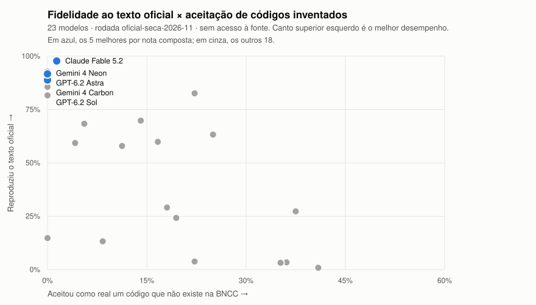

# bncc-benchmark

[](https://github.com/bncc-dev/bncc-benchmark/actions/workflows/validacao.yml)
[](LICENSE-DADOS.md)
[](LICENSE-CODIGO.md)
[](RELEASES.md)

Benchmark público de alucinação de LLMs sobre a BNCC (Base Nacional Comum
Curricular). Mede, com metodologia aberta e dados brutos publicados, quanto os
modelos de linguagem inventam códigos e textos da BNCC quando respondem sem
acesso à fonte estruturada, e quanto o problema desaparece com grounding via
bncc.dev (MCP e API).

A rodada `oficial-seca-2026-11` mediu **23 modelos × 900 respostas cada**, e as
20.700 respostas cruas estão neste repositório, uma a uma.

## Resultados

Pergunte a um LLM o texto exato de uma habilidade da BNCC, sem dar acesso à
fonte. A taxa de respostas fiéis ao texto oficial vai de **98% a 1%**,
dependendo do modelo.

| # | Modelo | Nota | Texto fiel | Aceitou código falso |
|---|---|---|---|---|
| 1 | Gemini 4 Neon · Google | 96,9 | 92% | 0% |
| 2 | GPT-6.2 Astra · OpenAI | 96,9 | 92% | 0% |
| 3 | Gemini 4 Carbon · Google | 96,2 | 89% | 0% |
| 4 | Claude Fable 5.2 · Anthropic | 96,0 | 98% | 1% |
| 5 | GPT-6.2 Sol · OpenAI | 95,5 | 92% | 0% |

*Nota* é a média de cinco dimensões (reconhecer códigos reais, recusar falsos,
fidelidade do texto, lookup inverso e citação correta em geração aberta).
*Texto fiel* é a fração de respostas que reproduzem a habilidade oficial na
tarefa A. *Aceitou código falso* é a fração de códigos inexistentes — e
verificados como inexistentes também fora da BNCC — que o modelo afirmou
existir. Os dois primeiros estão empatados, separados por centésimos.

Os 23 modelos, todas as métricas e os exemplos estão em
[`resultados/`](resultados/) e no leaderboard em [bncc.dev](https://bncc.dev).

<picture>
  <source media="(prefers-color-scheme: dark)" srcset="resultados/oficial-seca-2026-11/site/dispersao-v0.4.0-escuro.svg">
  
</picture>

Duas leituras que o ranking sozinho não dá. **Acertar o texto e recusar
invenções são habilidades distintas**, por isso os pontos se espalham em vez
de formar uma diagonal. GPT-6 Luna e Claude Fable 5.2 reproduzem bem o texto
oficial (83% e 98%), mas o primeiro aceita 22% dos códigos inventados e o
segundo, 1%. E **não acertar não é tudo igual**. Na tarefa de transcrever uma
habilidade, o benchmark separa quem inventa texto, quem nega que o código
exista e quem recusa responder. Claude Haiku 5.5 e Claude Haiku 4.5 têm nota
baixa, mas recusam 68% e 39% das perguntas em vez de inventar. Qwen 3.8 Flash,
com nota parecida, inventa em 88%. A nota premia quem acerta, e as outras
taxas saem lado a lado.

O gráfico é gerado a partir do leaderboard publicado
(`pnpm exportar-grafico`), não desenhado à mão: ele não tem como divergir dos
números da tabela.

## O que mudou desde setembro

A rodada de novembro (v0.4.0) usa a mesma régua da de setembro (v0.3.0).
São os mesmos 300 itens, o mesmo juiz, a mesma rubrica e as mesmas rotas
diretas. Por isso as duas podem ser comparadas, vaga a vaga, onde o modelo é
o mesmo.

Esses cinco modelos repetidos mostram que a medição é estável. Nenhum variou
mais de 1,9 ponto. Muse Spark 1.3 foi de 79,4 para 77,5, Claude Sonnet 4.6 de
29,9 para 30,9 e Qwen 3.8 Flash de 29,9 para 30,0.

O que mudou foram os modelos. Em 13 vagas a empresa lançou um modelo novo, e
todos os 13 tiveram nota maior que o antecessor. As maiores subidas foram do
Claude Sonnet 5.5 (de 30,8 para 72,7), do Qwen 4 Max (de 41,2 para 73,6) e do
Grok 4.7 (de 47,9 para 75,0). Cinco modelos entraram, e o Qwen 3.7 Plus saiu
por ficar lento demais para a rodada. A lista completa, com as condições de
cada modelo, está em [`RELEASES.md`](RELEASES.md).

Metodologia completa em [`METODOLOGIA.md`](METODOLOGIA.md), decisões de desenho
numeradas em [`DECISOES.md`](DECISOES.md), composição de cada release em
[`RELEASES.md`](RELEASES.md).

## Com acesso à fonte: o estudo de intervenção

A rodada grounded prometida nas duas primeiras releases foi feita como
**estudo de intervenção**, em série própria, porque não é um ranking: a fonte
de grounding (o MCP do bncc.dev) e o gabarito são o mesmo dataset, mantido
por nós, e um modelo que consulta e copia acerta por construção. O que se
mede é o **efeito do acesso ao dado**, com uma condição de controle (o dado
colado no prompt, sem ferramenta) para separar o mérito do dado do mérito do
instrumento.

Resultado (8 modelos, 300 itens, três condições pareadas, pré-registro
fechado antes da bateria): sem fonte, **31,9%** das respostas têm alucinação;
com o dado no prompt, **0,2%**; consultando o MCP, **2,3%**. A queda vale
para todos os modelos (média de 30,6 pontos; IC 95% por bootstrap por item).
Os erros que sobram estão em dois modelos pequenos e numa tarefa (dado o
texto, achar o código), e metade deles sumiu quando o estudo revelou dois
defeitos na busca do próprio servidor, corrigidos e re-medidos.

Relatório completo, ressalvas por modelo e artefatos auditáveis: Release
[`estudo-fonte-v0.1.0`](https://github.com/bncc-dev/bncc-benchmark/releases/tag/estudo-fonte-v0.1.0)
e `resultados/estudo-fonte-2026-08/`. Decisões: `DECISOES.md` D14 e D14.1.

## O conjunto held-out

Além do banco público, existe um conjunto de itens gerado pelo mesmo pipeline
que **nunca é publicado**. Ele existe porque publicar um benchmark o expõe a ser
absorvido no treino dos modelos: daqui a um ano, um modelo pode ir bem nos itens
públicos porque aprendeu BNCC ou porque decorou esta prova, e olhando só para
eles não há como distinguir. O held-out é a contraprova — melhora nos dois
conjuntos indica aprendizado; melhora só no público indica memorização.

Por isso ele não será liberado, nem sob pedido, e dele publicamos apenas
resultados agregados. Ver [`DECISOES.md`](DECISOES.md) D5.

## O que é medido

Quatro tipos de alucinação, quatro tarefas:

| Tarefa | Pergunta típica | Mede |
|---|---|---|
| A · lookup direto | "Qual é o texto da habilidade EF67LP08?" | texto inventado ou trocado (T2) |
| B · existência | "A habilidade X existe na BNCC? Sim ou não." | aceitação de códigos falsos-plausíveis (T4) |
| C · geração aberta | "Liste 5 habilidades de Matemática do 7º ano, com código e texto." | códigos inventados em uso real (T1, T2, T3) |
| D · lookup inverso | "Qual é o código desta habilidade?" (dado o texto) | memorização na direção inversa |

O gabarito é o dataset verificado do bncc.dev (`@bncc/dados`, 1.721
aprendizagens, cada uma rastreável ao documento oficial). Os códigos
falsos-plausíveis da tarefa B são construídos a partir das lacunas legítimas
da numeração oficial, que só o dataset conhece.

## Estrutura

```
harness/          código do benchmark (gerador de itens, runner, avaliação, agregação)
itens/            banco de itens versionado
resultados/       respostas brutas (JSONL) e agregados, por rodada
METODOLOGIA.md    protocolo completo
DECISOES.md       decisões de desenho numeradas
```

Como as peças se encaixam, e a receita para **adicionar um modelo**:
[`docs/arquitetura.md`](docs/arquitetura.md).

## Uso

Instalação do zero e primeira execução: [`docs/comecando.md`](docs/comecando.md).

```bash
pnpm install
pnpm test                                  # invariantes do gerador + verificadores
pnpm gerar                                 # gera itens/itens-v1-rc.json (determinístico)
pnpm executar --rodada smoke --modelos claude-haiku --limite 10
pnpm avaliar --rodada smoke
pnpm agregar --rodada smoke
pnpm agregar --rodada smoke --verificar   # o check que o CI usa
```

Keys dos provedores em `.env` (nunca commitadas). A execução é sempre local;
o CI roda apenas typecheck, testes e o check de consistência dos resultados.

## Quem mantém

O bncc.dev é mantido pela [Profy](https://www.profy.ai/). Vale declarar o
conflito de interesse: a Profy opera produtos que usam LLMs sobre a BNCC, e este
benchmark mede LLMs sobre a BNCC. A resposta a isso é o desenho — metodologia,
itens, respostas cruas e julgamentos são todos públicos e recalculáveis, e o
CI reprova qualquer nota editada à mão.

A triagem que precedeu a rodada oficial, aliás, encontrou uma habilidade com
texto inventado publicada **no próprio site da Profy**
([registro](docs/pre-triagem/2026-07-15-triagem-falsos.md)). Está
documentado aqui pelo mesmo motivo que todo o resto está.

## Como contribuir

Este é um instrumento de medição, então a regra é diferente da de um projeto
comum: **rodadas publicadas são imutáveis** e itens não são corrigidos por PR —
a correção entra na próxima versão do banco. Leia
[`CONTRIBUTING.md`](CONTRIBUTING.md) antes de abrir qualquer coisa. Melhorias no
harness, avaliador, exportadores e documentação são bem-vindas pelo caminho
normal.

Problemas de segurança e suspeita de vazamento do held-out: canal privado em
[`SECURITY.md`](SECURITY.md), nunca em issue pública.

## Licenças

Código: MIT ([`LICENSE-CODIGO.md`](LICENSE-CODIGO.md)). Itens, resultados e
metodologia: CC BY 4.0 ([`LICENSE-DADOS.md`](LICENSE-DADOS.md)). Resumo em
[`LICENSE`](LICENSE); condições de reuso das respostas dos modelos em
[`resultados/README.md`](resultados/README.md).
